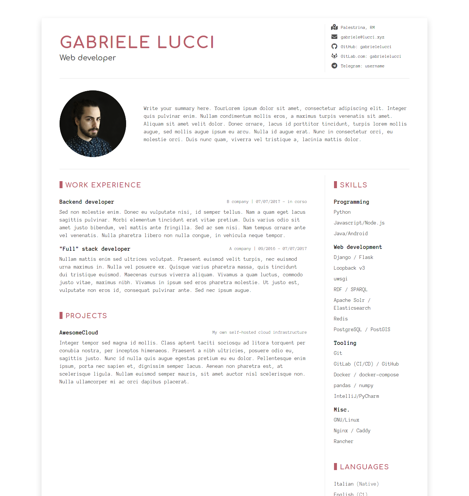

# Hugo DevResume Theme

This is a slight re-design of [DevResume](//github.com/xriley/DevResume-Theme) - a great looking resume/CV template 
designed for developers by Xiaoying Riley. 

This is based on [Jerry Kiely's Hugo port](//github.com/cowboysmall-tools/hugo-devresume-theme), 
with some tweaks to suit my needs.

## Screenshot

## Features

### Original

- Fully Responsive
- HTML5 + CSS3
- Built on Bootstrap 4
- 1000+ FontAwesome icons
- SCSS source files included
- Compatible with all modern browsers

### Changes

- Improved layout for small devices
- Fonts, using Anonymous Pro for paragraphs and Comfortaa for titles
- Everything is bundled and managed by npm
- Multilingual: English and Italian strings, a language switcher and `hreflang` links
- Refreshed look: warm neutrals around the original rose, a floating sheet, and a dark
  colour scheme that follows the system setting (print always uses the light one)
- ATS-friendly print: one A4 page, real text (no icon glyphs) for contact details,
  semantic heading levels

### Config notes

- Contact items take an optional `label` (printed in place of the icon, e.g. `Email: …`)
  and `print = false` to leave an item off the printout.
- A contact item with `env = "HUGO_…"` takes its text from that environment variable at
  build time, appended to `url` for the link (e.g. `url = "tel:"`), and is left out when
  the variable is unset. Use it for details that must stay out of the repository and the
  published site, such as a phone number.
- Experience items take `start`/`end` as `"YYYY-MM"`; month names follow the site
  language, and a missing `end` reads as "Present". The free-form `dates` still works.
- `params.legal.text`, when set, is printed at the bottom of the resume (e.g. a GDPR
  consent line for Italian CVs).

## Getting Started

## Installation

Within the root of your Hugo project execute the following:

    git clone https://github.com/cowboysmall-tools/hugo-devresume-theme.git themes/hugo-devresume-theme

### Setup

Pull Bootstrap and fonts using npm:

    npm install

Copy [`exampleSite/config.toml`]() to the root of your Hugo site:

    cp exampleSite/config.toml ../../config.toml 

Edit `config.toml` and add your relevant information.

You are good to go! You can preview your website with: 

    hugo server
    
Or you can generate your site wih:

    hugo

## License

Copyright (C) 2020 Gabriele Lucci

Licensed under [MIT](LICENSE) except where noted.
